::: {style="text-align: center; color: orange;"}
TRABALLANDO NELA!
:::

O galego, a lingua propia e vehicular da militancia, presenta unha serie de palabras pouco empregadas fóra da militancia debido á influencia do castelán na sociedade galega. Nesta sección expóñense co obxectivo de familiarizar ás integrantes coa xerga propia. Tamén se presentan palabras que, malia ser de uso común, tenden a ser empregadas incorrectamente.

Este glosario non pretende ser un dicionario nin substituílo. O obxectivo é presentar, de xeito amigable, as diferentes palabras e conceptos que se empregan na militancia, así como a súa definición (non formal) e, cando sexa posible, unha imaxe que ilustre o concepto.

As palabras que se empregan comunmente, en negriña, atópanse ordeadas dende o A até o Z. A continuación escríbense as palabras, en cursiva, en norma ILG-RAG e norma AGAL. No caso de existir unha entrada nalgún dicionario de galego (priorizando o [Dicionario RAG](https://academia.gal/inicio){target="_blank"} e o [Dicionário Estraviz](https://www.estraviz.org/){target="_blank"}, respectivamente) achégase a ligazón:

- [**Acta**]{#def-acta}; *Acta* | *Ata* \[[ILG-RAG](https://academia.gal/dicionario/-/termo/acta){target="_blank"} \| [AGAL](https://estraviz.org/ata){target="_blank"}\]:
  Documento no que se recollen os acordos e o acontecementos relevantes, como intervencións que aporten ao debate, nunha [asemblea](#def-asemblea). As actas son mandadas antes da próxima asemblea para que a militancia teña a oportunidade de lelas e comprobar se o escrito é certo. Ao comezo de cada asemblea vótase a favor ou en contra do borrador de acta da asemblea anterior e, de ser aprovada, pasa a ser oficial.

{fig-align="center" width="75%"}

-   [**Afiliada**]{#def-afiliada}; *Afiliada* | *Afiliada* \[[ILG-RAG](https://academia.gal/dicionario/-/termo/afiliado){target="_blank"} \| [AGAL](https://estraviz.org/afiliado){target="_blank"}\]:
  Persoa que forma parte dunha organización. No caso de existir unha cota monetaria cúbrea. Teñen dereito a voz e voto nas [asembleas](#def-asemblea).
  Confróntese con [militante](#def-militante).

-   [**Asemblea**]{#def-asemblea}; *Asemblea* | *Assembleia* \[[ILG-RAG](https://academia.gal/dicionario/-/termo/asemblea){target="_blank"} \| [AGAL](https://estraviz.org/asemblea){target="_blank"}\]:
  Reunión de persoas que forman parte dunha organización con capacidade de toma de decisións. Tipicamente hai unha figura de moderadora, polo xeral é unha persoa veterana cun cargo orgánico, que le a [orde do día](#def-orde_do_dia), distribúe as quendas de palabra e tenta que se desenvolva dun xeito adecuado. Os feitos e decisións que transcorren na asemblea escríbense nunha [acta](#def-acta).

[ENGADIR FOTO]

- [**Cartaz**]{#def-cartaz}; *Cartel* | *Cartaz* \[[ILG-RAG](https://academia.gal/dicionario/-/termo/cartel){target="_blank"} \| [AGAL](https://estraviz.org/cartaz){target="_blank"}\]:
  Superficie de papel de tamaño variable con fin propagandístico e de difusión dunha acción, problemática, acto, etc.
  Tipicamente referido como *cartaz* (malia que a norma ILG-RAG non o recoñeza).

[ENGADIR FOTO]

- [**Colada**]{#def-colada}; *Colada* | *Colado* \[[ILG-RAG](https://academia.gal/dicionario/-/termo/colar){target="_blank"} \| [AGAL](https://estraviz.org/colar){target="_blank"}\]:
  Acción de pegar material, tipicamente [cartaces](#def-cartaz), propagandístico en lugares públicos, como paredes, paradas de bus, etc. Normalmente realízase en grupo. A distribución adoita ser unha persoa estendendo, cunha vasoira ou cun cepillo, unha mestura de cola disolta en auga (adoita levarse nun cubo) sobre unha superficie para que outra persoa, a que leva o material, coloque o cartaz sobre o adhesivo. Unha vez pegado vólveselle a dar outro baño de cola por riba para que quede ben fixo.

[ENGADIR FOTO]

- [**Colante**]{#def-colante}; *Adhesivo* | *Autocolante* \[[ILG-RAG](https://academia.gal/dicionario/-/termo/adhesivo){target="_blank"} \| [AGAL](https://estraviz.org/autocolante){target="_blank"}\]:
  Lámina de tamaño e forma variable con adhesivo polo envés, cuberto cun papel que evita que se seque ou manche e que se retira á hora de colalo, e cunha mensaxe ou ilustración pola face. Adóitan ser pegados en paredes, farolas, buzóns, etc.
  Tamén coñecido como *autocolante* ou, coloquialmente, *pegata*.

::: {layout-ncol=2 fig-align="center" style="max-width: 75%; margin: 0 auto;" out-width="75%"}
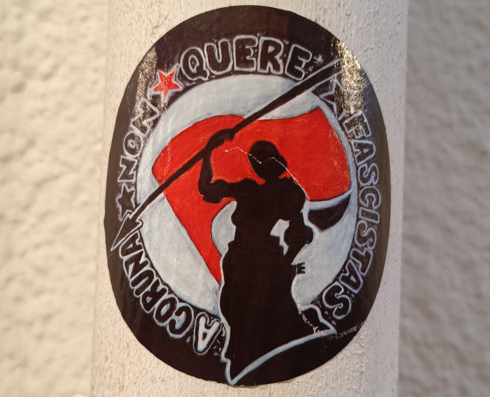

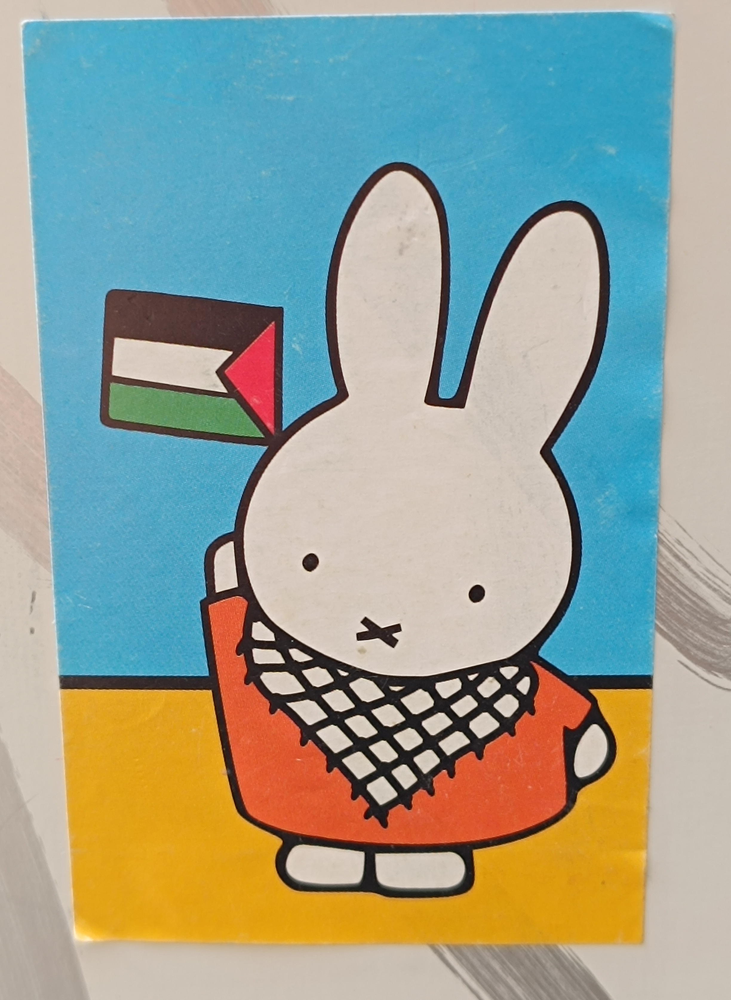
:::

- [**Concentración**]{#def-concentracion}; *Concentración* | *Concentraçom* \[[ILG-RAG](https://academia.gal/dicionario/-/termo/concentración){target="_blank"} \| [AGAL](https://estraviz.org/concentracion){target="_blank"}\]:
  [Mobilización](#def-mobilizacion) nunha localización estática. Adóitase crear un círculo de [faixas](#def-faixa) ou unha fronte. Polo xeral duran entre media hora e unha hora.
  Confróntese con [manifestación](#def-manifestacion).

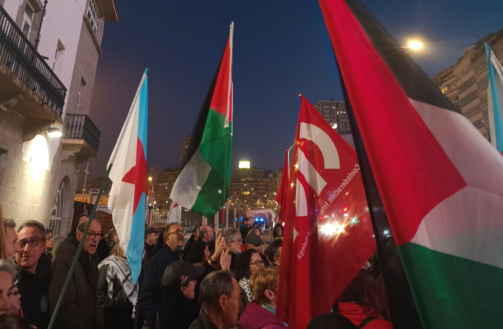{fig-align="center" width="75%"}

- [**Crachá**]{#def-cracha}; *XXX* | *XXX* \[[ILG-RAG](https://academia.gal/dicionario/-/termo/XXX){target="_blank"} \| [AGAL](https://estraviz.org/XXX){target="_blank"}\]:
  Folla metálica con forma variable. Presenta unha imaxe na face e un imperdible no envés para unilo a un tecido.

  Pendente buscar o nome en ILG-RAG e AGAL

[ENGADIR FOTO]

-   [**Desafiuzar**]{#def-desafiuzar}; *Desafiuzar* | *Despejar* \[[ILG-RAG](https://academia.gal/dicionario/-/termo/desafiuzar){target="_blank"} \| [AGAL](https://estraviz.org/despejar){target="_blank"}\]:
  Acción de botar a unha persoa ou grupo de persoas dunha vivenda por indicación dun xurista (xuíz?). Execútase polo corpo policial cando existe resistencia por parte da(s) persoa(s) a quen quere(n) botar.

[ENGADIR FOTO]

-   [**Estraza**]{#def-estraza}; *---* | *---* \[[ILG-RAG](https://academia.gal/){target="_blank"} \| [AGAL](https://estraviz.org/){target="_blank"}\]:
  Tira de papel, xeralmente de cor marrón, na que se escribe unha mensaxe reivindicativa ou se anuncia un evento. Adoitan ser coladas en superficies con cinta adhesiva e, en menor medida, con cola. O papel de estraza tamén é coñecido como papel kraft. 
  Non confundir con [cartaz](#def-cartaz) ou [faixa](#def-faixa).

  Pendente buscar o nome en ILG-RAG e AGAL

[ENGADIR FOTO]

-   [**Estreleira**]{#def-estreleira}; *---* | *---*  \[[ILG-RAG](https://academia.gal/){target="_blank"} \| [AGAL](https://estraviz.org/){target="_blank"}\]:
  Bandeira galega cunha estrela vermella de cinco puntas no centro, símbolo do [nacionalismo](#def-nacionalismo) galego de esquerdas. Tamén é coñecida como bandeira da patria (ou matria). Adoitan exhibirse en [concentracións](#def-concentracion) e [manifestacións](#def-manifestacion), mais tamén en actos políticos ligados ao nacionalismo galego de esquerdas.

::: {layout-ncol=2 fig-align="center" style="max-width: 75%; margin: 0 auto;" out-width="75%"}

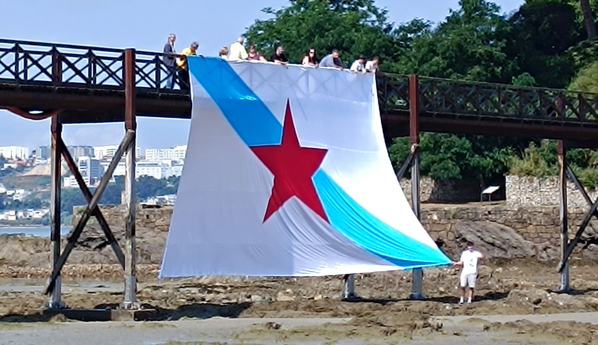
:::

[Falta engadir as referencias xa que non se atopa nin no DRAG nin no Estraviz, a redirección é cara a páxina principal dos dicionarios]

-   [**Faixa**]{#def-faixa}; *Pancarta* | *Pancarta* \[[ILG-RAG](https://academia.gal/dicionario/-/termo/pancarta){target="_blank"} \| [AGAL](https://estraviz.org/pancarta){target="_blank"}\]:
  Superficie rectangular na que se debuxa ou se escribe unha mensaxe reivindicativa. O material acostuma a ser plástico e pódese debuxar e escribir sobre el coa axuda de rotuladores. Existen casos nos que as faixas son creadas por empresas. Adoita ser pendurada nunha superficie vertical ou carregada por militantes nunha [mobilización](#def-mobilizacion). 
  Tipicamente referido como *faixa* (malia que as normas ILG-RAG e AGAL non o recoñezan).

::: {layout-ncol=2 fig-align="center" style="max-width: 75%; margin: 0 auto;" out-width="75%"}
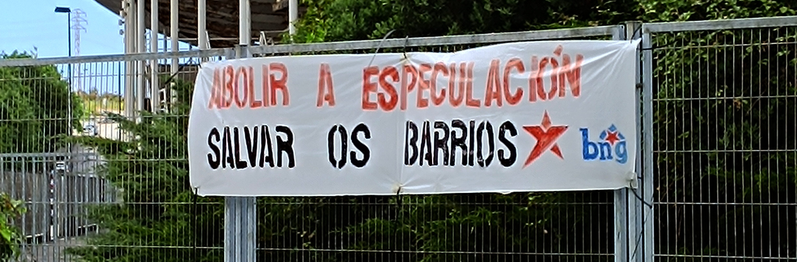

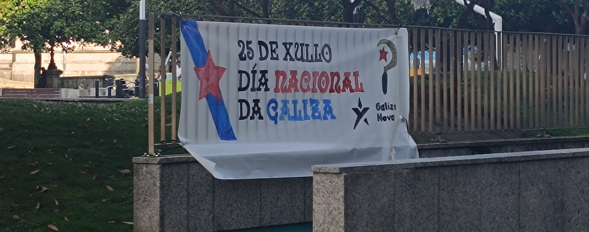
:::

-   [**Foliada**]{#def-foliada}; *Foliada* | *Foliada* \[[ILG-RAG](https://academia.gal/dicionario/-/termo/foliada){target="_blank"} \| [AGAL](https://estraviz.org/foliada){target="_blank"}\]:
  Festa na que se xuntan persoas para bailar e tocar música tradicional. Adoita celebrarse en espazos públicos como prazas ou en espazos privados como centros sociais.

[ENGADIR FOTO]

- [**Independentismo**]{#def-independentismo}; *Independentismo* | *Independentismo* \[[ILG-RAG](https://academia.gal/dicionario/-/termo/independentismo){target="_blank"} \| [AGAL](https://estraviz.org/independentismo){target="_blank"}\]:
  Movemento sociopolítico que busca a escisión política dun territorio fronte a outro, en moitos casos dunha nación fronte ao Estado ao que pertencen para, deste xeito, constituír un Estado de seu. Tamén se coñece como secesionismo.

[ENGADIR FOTO]

-   [**Manifestación**]{#def-manifestacion}; *Manifestación* | *Manifestaçom* \[[ILG-RAG](https://academia.gal/dicionario/-/termo/manifestación){target="_blank"} \| [AGAL](https://estraviz.org/manifestación){target="_blank"}\]:
  [Mobilización](#def-mobilización) de persoas dinámica, comézase nun punto A e, após un percorrido, vólvese ao punto A ou vaise a un punto B. Adóitase ir nunha marcha constante e agrupadas por organizacións, cada unha detrás dunha [faixa](#def-faixa). Teñen unha duración bastante diversa, dependendo da gravidade da problemática e da lonxitude do traxecto, polo que adoitan durar dunha hora a tres. O manifesto lese ao se deter a manifestación, tratando de formar unha fronte ou un círculo.
  Confróntese con [concentración](#def-concentracion).

::: {layout-ncol=2 fig-align="center" style="max-width: 75%; margin: 0 auto;" out-width="75%"}
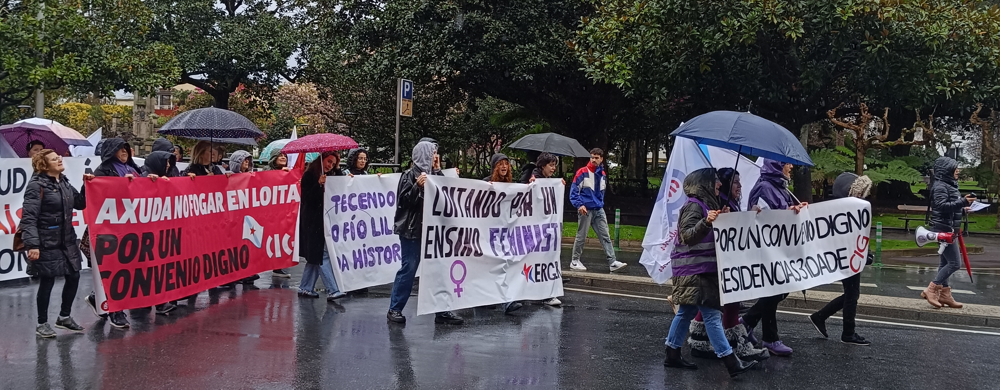

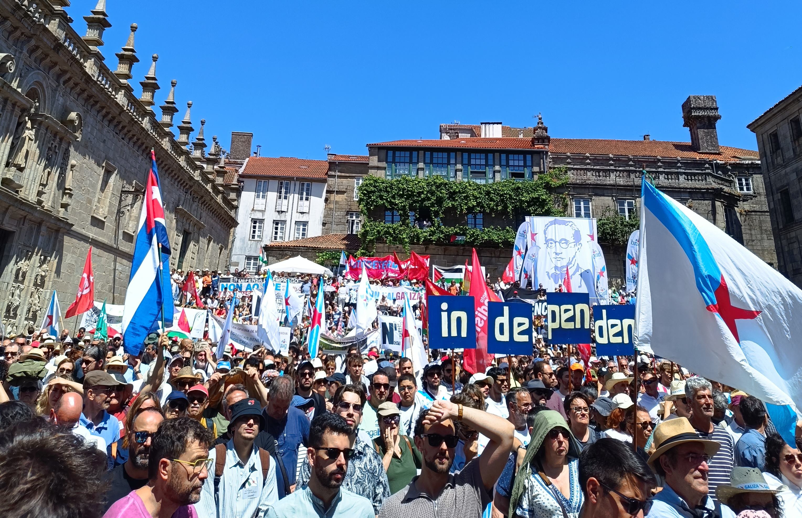
:::

-   [**Militante**]{#def-militante}; *Militante* | *Militante* \[[ILG-RAG](https://academia.gal/dicionario/-/termo/militante){target="_blank"} \| [AGAL](https://estraviz.org/militante){target="_blank"}\]:
  Subconxunto de [afiliadas](#def-afiliada) que toman un papel activo na organización social. Dito doutro xeito, toda militante é afiliada, pero non toda afiliada é militante. Preséntanse a [mobilizacións](#def-mobilizacion), participan en [asembleas](#def-asemblea), executan [coladas](#def-colada), etc.
  Confróntese con [afiliada](#def-afiliada).

[ENGADIR FOTO]

- [**Mobilización**]{#def-mobilizacion}; *Mobilización* | *Mobilizaçom* \[[ILG-RAG](https://academia.gal/dicionario/-/termo/mobilización){target="_blank"} \| [AGAL](https://estraviz.org/mobilización){target="_blank"}\]:
  Xuntanza de persoas cun obxectivo reivindicativo, axitativo e de visibilización dunha problemática, polo xeral respecto a unha mala xestión ou unha emerxencia. No desenvolvemento bérranse diferentes consignas que evidencien a problemática. Rematan coa lectura dun manifesto expoñendo os feitos e exixindo solucións a quen sexa responsable. Adoitan ser convocadas por unha ou varias organizacións con tempo previo abondo para maximizar a participación da sociedade. Precisamente, poden ser secundadas por múltiples organizacións (aínda non sendo quen as convoque). As participantes non teñen por que pertencer a ningún colectivo, poden ser persoas independentes aos distintos movementos sociais. Exemplos de mobilización son as [concentracións](#def-concentracion) e as [manifestacións](#def-manifestacion).

[ENGADIR FOTO]

- [**Nación**]{#def-nacion}; *Nación* | *Naçom* \[[ILG-RAG](https://academia.gal/dicionario/-/termo/nación){target="_blank"} \| [AGAL](https://estraviz.org/nacion){target="_blank"}\]:
  Colectivo constituído por persoas que comparten unha serie de características comúns como historia, lingua, cultura, economía, idiosincrasia, etc.

, [CC BY-SA 3.0](https://creativecommons.org/licenses/by-sa/3.0/))](imaxes/glosario/nacion.svg){fig-align="center" width="75%"}

-   [**Nacionalismo**]{#def-nacionalismo}; *Nacionalismo* | *Nacionalismo* \[[ILG-RAG](https://academia.gal/dicionario/-/termo/nacionalismo){target="_blank"} \| [AGAL](https://estraviz.org/nacionalismo){target="_blank"}\]:
  Ideoloxía e movemento sociopolítico que pon o foco na [nación](#def-nacion). Busca unhas mellores condicións para a mesma, a defensa da súa identidade e un recoñecemento da propia nación.
  Confróntese con [soberanismo](#def-soberanismo) e [independentismo](#def-independentismo).

[ENGADIR FOTO]

- [**Orde do día**]{#def-orde_do_dia}; *Orde do día* | *Ordem do dia* \[[ILG-RAG](https://academia.gal/dicionario/-/termo/orde){target="_blank"} \| [AGAL](https://estraviz.org/orde){target="_blank"}\]:
  Conxunto de cuestións ordeadas que van ser tratadas nunha [asemblea](#def-asemblea). Adoita comezar coa *aprobación, se procede, da anterior [acta](#def-acta)* e remata cun punto de *varios*, onde se poden tratar cuestións que non se reflectiran na orde do día, mais sen toma de decisións.

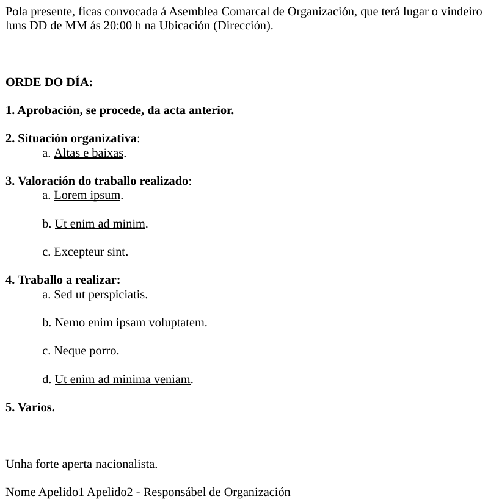{fig-align="center" width="75%"}

- [**Palestra**]{#def-palestra}; *Palestra* | *Palestra* \[[ILG-RAG](https://academia.gal/dicionario/-/termo/palestra){target="_blank"} \| [AGAL](https://estraviz.org/palestra){target="_blank"}\]:
  Acto formativo no que se expoñen unha serie de ideas dunha temática concreta por parte dunha ou varias persoas (coñecidas como palestrante) formadas no tema cun público presente. Ao rematar a intervención das palestrantes é común abrir unha rolda de preguntas na que participa o público para aclarar conceptos ou dúbidas.

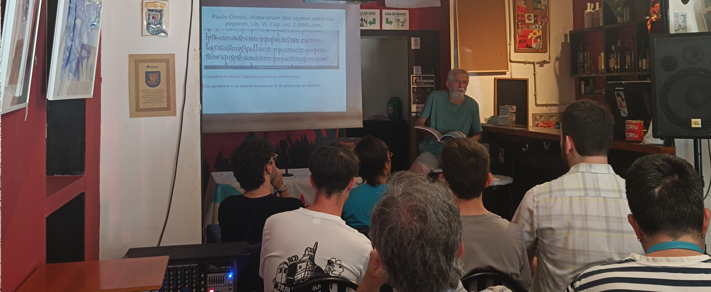{fig-align="center" width="75%"}

- [**Pintada**]{#def-pintada}; *Pintada* | *???* \[[ILG-RAG](https://academia.gal/dicionario/-/termo/pintada){target="_blank"} \| [AGAL](https://estraviz.org/){target="_blank"}\]:
  [PENDENTE]

::: {layout-ncol=2 fig-align="center" style="max-width: 75%; margin: 0 auto;" out-width="75%"}
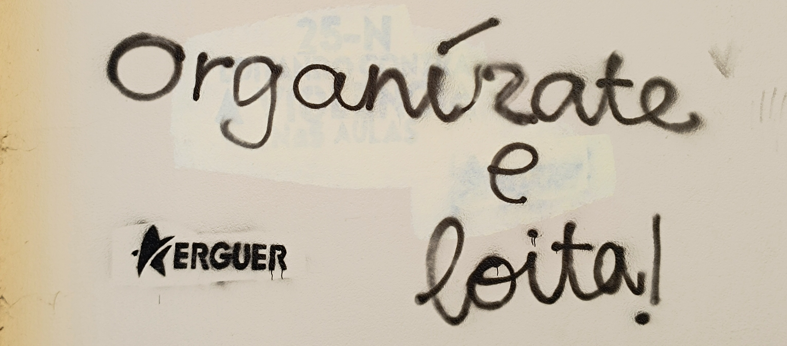

:::

-   [**Simpatizante**]{#def-simpatizante}; *Simpatizante* | *Simpatizante* \[[ILG-RAG](https://academia.gal/dicionario/-/termo/simpatizante){target="_blank"} \| [AGAL](https://estraviz.org/simpatizante){target="_blank"}\]:
  Persoa que apoia unha organización ou causa, mais non forma parte dela. En moitos casos solicitan información e presentan interese en coñecer en que participa a organización.

[ENGADIR FOTO]

-   [**Soberanismo**]{#def-soberanismo}; *Soberanismo* | *Soberanismo* \[[ILG-RAG](https://academia.gal/dicionario/-/termo/soberano){target="_blank"} \| [AGAL](https://estraviz.org/soberano){target="_blank"}\]:
  Movemento sociopolítico no que se exixe a soberania, é dicir, o poder de decisión e autoridade máxima nun territorio. O obxectivo é que a cidadanía teña a capacidade de decidir que vai ser co seu futuro político, econímico e social, non estando subordinadas a un poder xurídico externo.
  Confróntese con [nacionalismo](#def-nacionalismo) e [independentismo](#def-independentismo).

[ENGADIR FOTO]

-   [**Voandeira**]{#def-voandeira}; *Panfleto* | *Panfleto* \[[ILG-RAG](https://academia.gal/dicionario/-/termo/panfleto){target="_blank"} \| [AGAL](https://estraviz.org/panfleto){target="_blank"}\]: 
  Documento impreso, en moitas ocasións dobrado unha ou dúas veces, no que se expón brevemente un tema ou se anuncia un evento. Adoitan ser repartidas por [militantes](#def-militante) en espazos públicos nos denominados repartos. Tamén se poden deixar en, por exemplo, mesas de espazos públicos para que a xente poida tomalos a vontade. 
  Tipicamente referido como *voandeira* (malia que as normas ILG-RAG e AGAL non o recoñezan)

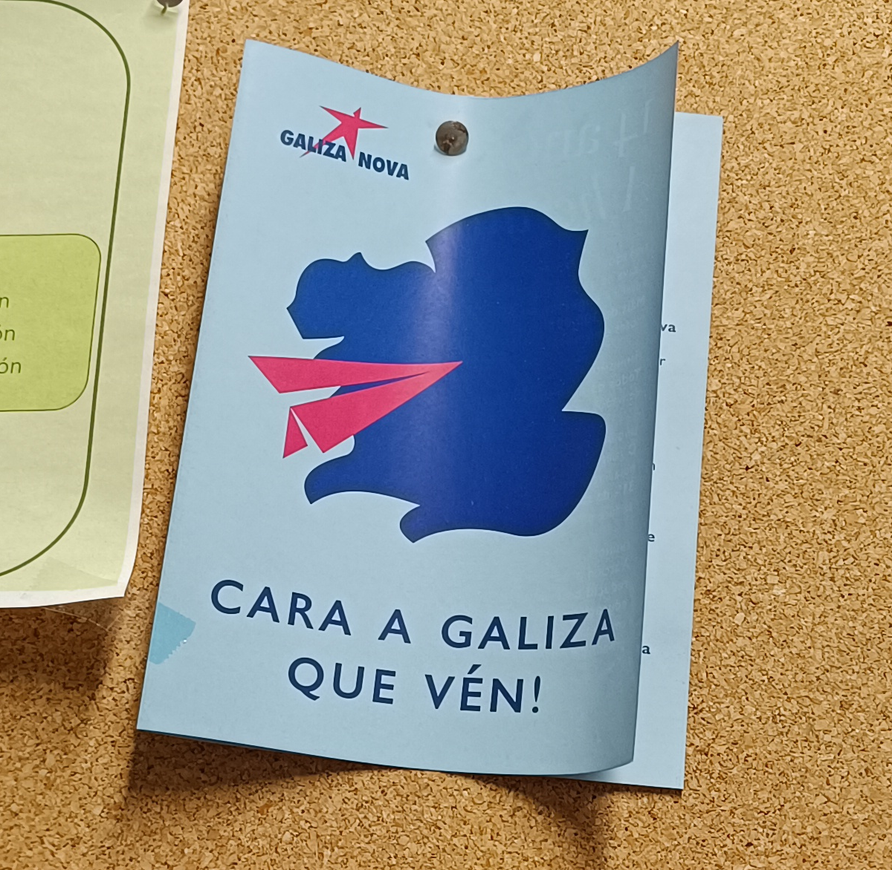{fig-align="center" width="75%"}

## Traballo pendente:
- Comprobar que todas as ligazóns funcionen correctamente.

-   Engadir imaxes que ilustren cada concepto. Para as faltantes, consultar coa militancia para pedir fotos.

-   Engadir separador por letra (A, B, ..., Z).
